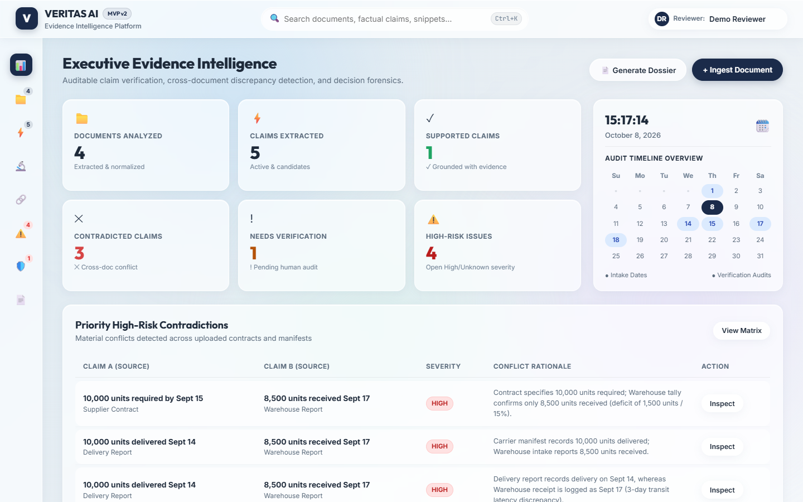
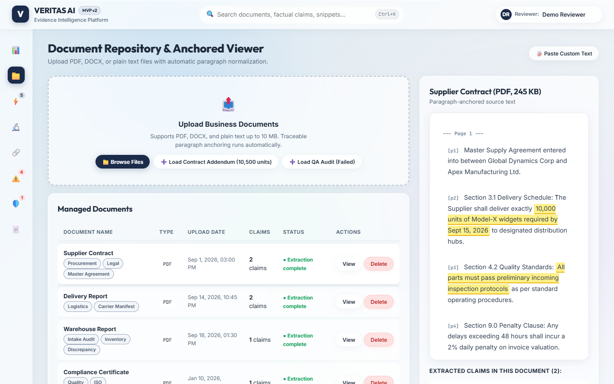
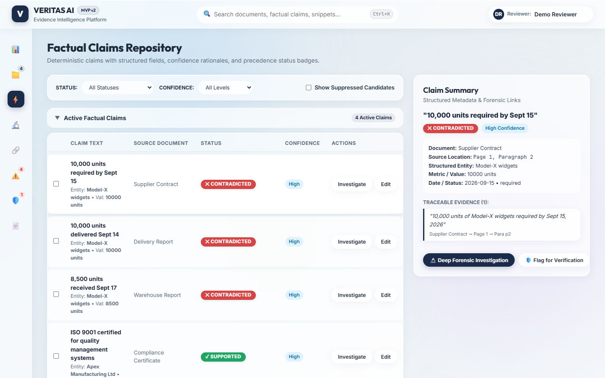
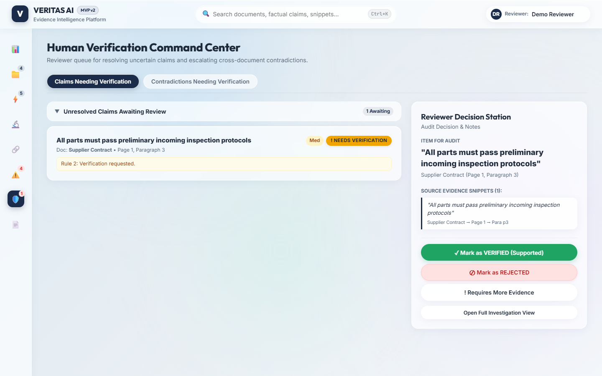

# VERITAS AI — Evidence Intelligence for Better Decisions

[](https://opensource.org/licenses/MIT)
[]()
[]()

> **Evidence Intelligence Platform**: Extracts factual claims from business documents, maps each claim to traceable source locations, detects cross-document contradictions (quantity, date, requirement, status, identity mismatches), and routes uncertain items to human verification.

---

## 📸 User Interface & Visual Showcase

| Dashboard Overview | Documents & Anchored Viewer |
|:---:|:---:|
|  |  |

| Factual Claims Repository | Human Verification Command Center |
|:---:|:---:|
|  |  |

---

## 🌟 Key Features

- **Soft Glass Design System**: Frosted glassmorphism (`backdrop-filter: blur(20px)`), calm blue-grey gradient canvas with ambient pastel depth blobs, and WCAG AA contrast compliance.
- **Strict Precedence Status Tokens**:
  - `✓ SUPPORTED` (#1fa463)
  - `✕ CONTRADICTED` (#d64545)
  - `! NEEDS VERIFICATION` (#f0a500 with dark navy text `#1e2a3a` for contrast)
  - `⊘ REJECTED` (#6b7280)
- **Deterministic Logic & No Hallucinations**:
  - Document text normalized into pages and numbered paragraphs (`p1`, `p2`, ...).
  - Exact character offset anchors (`Document → Page → Paragraph → chars a–b`).
  - Strict contradiction detection with severity formula adjustments (+1 High confidence, +1 multi-document, -1 both low confidence).
  - Strict verdict precedence resolution (Rule 1: Human decision → Rule 2: Low confidence/Unknown severity → Rule 3: Contradiction → Rule 4: Supported).
- **Two-Column Workspaces**: Master-detail layouts for Claims, Verification, Contradictions, and Documents.
- **Collapsible Status Groups**: Structured in `Unplanned / Scheduled / Done` pattern with count chips.
- **Today Calendar & Clock Widget**: Live time counter and mini month calendar showing intake & audit dates.
- **10-Second Undo Toast**: Live animated countdown with immutable reversal logging.
- **Executive Dossier & Reports**: One-click printable PDF report generation with audit snapshots.

---

## 🚀 Quick Start

### 1. Run Directly in Browser
You can open `index.html` directly in any modern web browser.

### 2. Run with Built-in Server
```bash
# Start local static server (Node.js)
node serve.js
```
Open [http://localhost:4173](http://localhost:4173) in your browser.

### 3. Run Validation Tests
```bash
node test_engine.js
```

---

## 📂 Project Architecture

```
├── index.html            # Semantic HTML5 shell & glass layouts
├── styles.css            # Soft Glass design tokens & responsive styles
├── engine.js             # Deterministic logic, extraction, contradictions, verdicts
├── data.js               # Initial pre-loaded demo case (Section 9)
├── app.js                # View controller, ingestion, and UI workflows
├── serve.js              # Lightweight local HTTP server
├── test_engine.js        # Automated unit test suite
├── take_screenshots.js   # Automated screenshot utility
├── screenshots/          # High-resolution screenshots of UI views
└── VERITAS_SPEC.md       # Product functional specification
```

---

## 📜 License
MIT License. Built for the ThinkRoot Hackathon.
